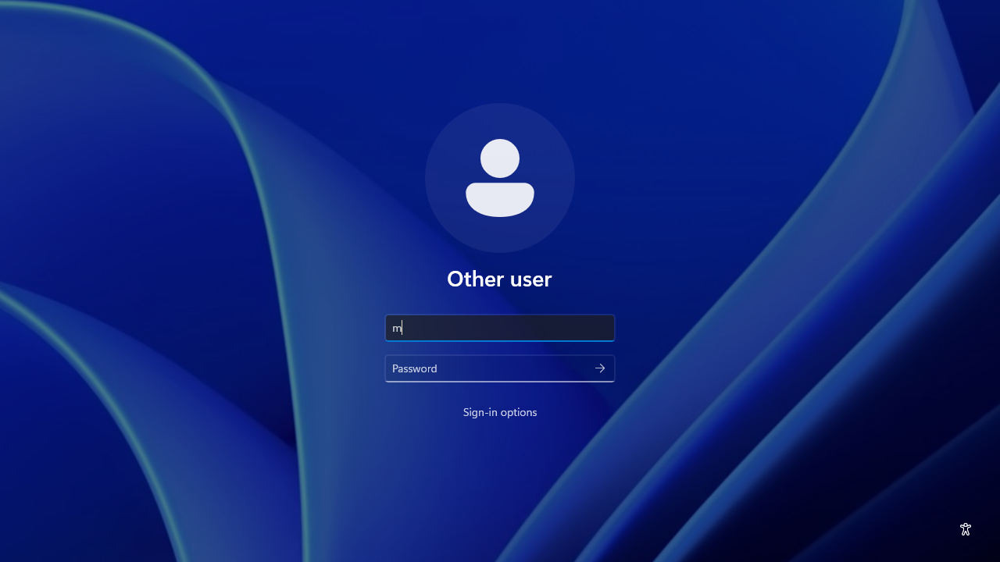
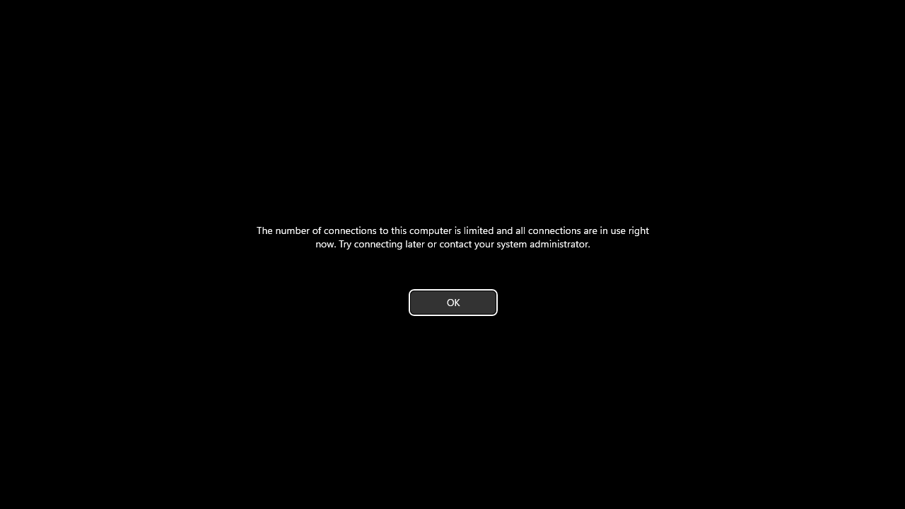
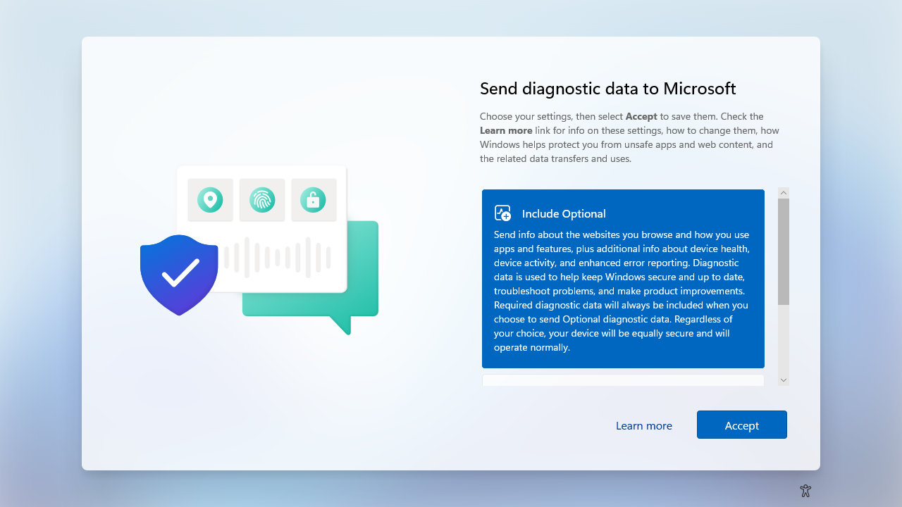
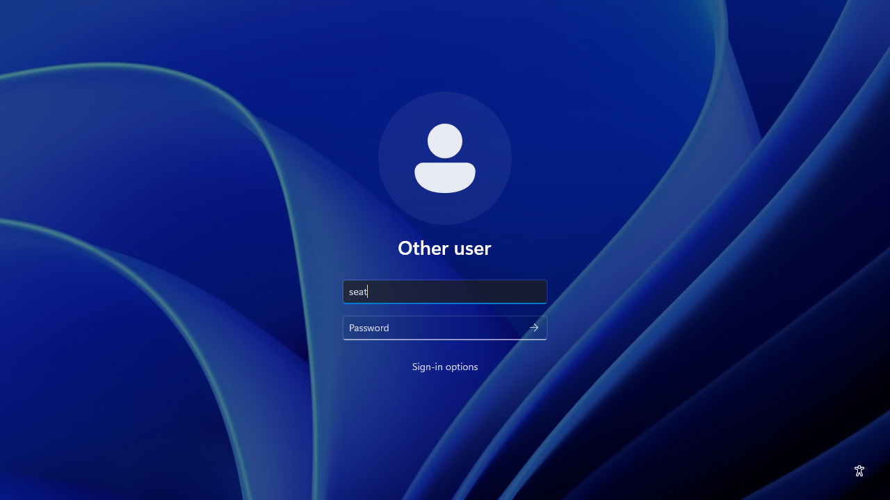

# ASTER-style MultiSeat: driver plan

Goal: each player gets a **real local Windows session** with **their own physical monitor, keyboard, mouse,
headset and USB devices**, at the **monitor's full refresh rate**, with **no Remote Desktop window** –
the way ASTER works.

Background: [research/aster-research.md](research/aster-research.md) (how ASTER works, what Windows allows,
driver signing rules). Short version:

- ASTER = one kernel driver (`mutenx.sys`) + a service. Each extra workplace is a real Windows session
  called "Multiseat" (not RDP). ASTER gives physical GPU outputs to those sessions through undocumented
  Windows graphics internals, which is why it breaks on Windows updates.
- Microsoft documents that **GPU monitors always belong to the console session**. The documented way to
  give another session a screen is a **Remote Desktop Protocol Provider + a remote Indirect Display Driver
  (IddCx)**.
- New kernel drivers must be **signed by Microsoft** (EV certificate + Partner Center) to load on normal PCs.
  Until then we develop with **test signing in a VM / test PC only**.

## Rules for this work

1. **Develop and test drivers only in the Hyper-V test VM or on a dedicated test PC** (test signing on,
   Secure Boot off). Never on the user's daily Windows.
2. **Never ship a test-signed driver to users.** Releases need Microsoft signing (Phase 5).
3. **No licensing workarounds.** No `termsrv.dll` patching, no RDP Wrapper, no bypassing the
   one-session limit of Windows 10/11 Pro. Multi-session target = **Windows Server** (RDSH licensing).
4. **ASTER: observe first, never copy.** Start with black-box observation and the kernel debugger
   (sessions, drivers loaded, displays seen from inside a workplace, fps, `!chkimg` on dxgkrnl/win32k,
   registered callbacks). Disassembling ASTER's driver only if that is not enough, only to learn how it
   uses Windows, and after checking ASTER's licence. Never copy ASTER code.
5. Every driver must be HVCI (Memory Integrity) compatible and must fail **safe**: if MultiSeat stops,
   every keyboard, mouse and monitor goes back to the main desktop.

## Phase 0 – Developer PC and test VM

On the user's PC (Windows Server or Windows 11), as Administrator:

```powershell
.\setup\dev\Install-DevTools.ps1          # VS 2022 + WDK + .NET 8 + Git + Inno Setup + WinDbg + Hyper-V
.\setup\dev\New-DriverTestVM.ps1 -IsoPath <Windows Server 2025 eval ISO>
# inside the VM after installing Windows:
C:\MultiSeatDev\Enable-DriverTesting.ps1 -HostIp <host IP on the Default Switch>   # then restart the VM
# on the host:
Checkpoint-VM -Name MultiSeatDriverTest -SnapshotName clean
```

After any blue screen in the VM: `Restore-VMCheckpoint -VMName MultiSeatDriverTest -Name clean -Confirm:$false`.

**Done when:** the VM boots in Test Mode and WinDbg on the host can attach to it.

## Phase 1 – Our own keyboard/mouse driver (`drivers/MultiSeatInput`)

A KMDF class upper filter below `kbdclass`/`mouclass` (pattern of the WDK `kbfiltr`/`moufiltr` samples).
Per device: PASS (to Windows) or CAPTURE (to MultiSeat). Monitor mode copies all input for pairing.
Replaces Interception (which is non-commercial-only and unmaintained).

```powershell
msbuild drivers\MultiSeatInput\MultiSeatInput.vcxproj /p:Configuration=Debug /p:Platform=x64
dotnet publish tools\InputProbe -c Release -r win-x64 --self-contained -o out\InputProbe
.\setup\dev\Deploy-ToTestVM.ps1 -Install          # copies + installs + restarts the VM
# in the VM (Administrator):
C:\MultiSeatDev\InputProbe.exe list
C:\MultiSeatDev\InputProbe.exe watch 20
C:\MultiSeatDev\InputProbe.exe capture <id> 10
```

**Tests (all must pass):**
- [ ] Builds with warnings-as-errors (done, 2026-11-19); Driver Verifier (`verifier /standard /driver MultiSeatInput.sys`) runs a full day with no bug check.
- [x] `list` shows every keyboard and mouse with its hardware id. (VM: VMBus keyboard, HID mouse, and RDP `TS_INPT` keyboard/mouse in enhanced session)
- [x] `watch` shows events with the right device id; nothing is lost on the desktop.
- [x] `capture` takes ONE device away (desktop ignores it, InputProbe shows it); other devices still work. (keyboard id 1/3 and mouse id 2 tested)
- [ ] Holding Ctrl while capture starts does not leave Ctrl stuck on the desktop. (held Enter was released correctly; Ctrl still to confirm)
- [ ] Killing InputProbe (Task Manager) gives the device back immediately.
- [ ] Plug/unplug while running: no crash, ids update.
- [ ] Works with HVCI (Memory Integrity) on.

**Then:** add a `MultiSeatInput` backend to `src/MultiSeat/Input` (same interface as the Interception
backend) and make it the default when the driver is present.

## Phase 2 – Display feasibility (the hard part)

Two paths are studied side by side:
- **Kernel path (ASTER-style, main goal):** a seat's session shows directly on one output of the same GPU.
  Needs a real test PC with a GPU – setup and observation steps: [test-pc.md](test-pc.md).
- **Documented path:** protocol provider + remote IddCx (questions 3–4 below). Can start in the VM.

**Results so far (test VM, 2026-11-19, SeatProbe):**

| Step | Session | Displays | DWM compositions/s |
|---|---|---|---|
| VMConnect enhanced session (RDP) | 1, protocol 2 | Microsoft Remote Display Adapter 1366x768 | **32** (RDP cap, `DWMFRAMEINTERVAL` not set) |
| A: Microsoft IddSampleDriver (console IddCx, test-signed) | console, protocol 0 | Hyper-V Video + 3 IDD monitors (1024x768@75, **2560x1440@144**, 3840x2160@60) | **144.1** |

Step A shows that a third-party, test-signed IddCx driver works and DWM composes at the IDD
monitor's full 144 Hz (even with software rendering in the VM). Still open: does a **non-console**
session get the same rate (step B: protocol provider + remote IDD)?

### Step B plan – "MultiSeat Local" protocol provider (test VM, Windows Server)

How Windows uses a provider ([Protocol Provider API](https://learn.microsoft.com/windows/win32/termserv/custom-remote-desktop-protocols)):
- A COM DLL loaded by Remote Desktop Services (TermService). Registered as a listener key
  `HKLM\SYSTEM\CurrentControlSet\Control\Terminal Server\WinStations\MultiSeat-Local`
  with `LoadableProtocol_Object` = CLSID of our `IWRdsProtocolManager`.
- Start: `Initialize` → `CreateListener` → `StartListen(callback)`.
- A seat opens when our listener calls `IWRdsProtocolListenerCallback::OnConnected` with our
  `IWRdsProtocolConnection`. Windows then calls, in order: `GetLogonErrorRedirector`, `AcceptConnection`,
  `GetClientData`, `GetClientMonitorData`, `GetUserCredentials`, `GetLicenseConnection`,
  `AuthenticateClientToSession`, `NotifySessionId`, `GetInputHandles`, `GetVideoHandle`, `ConnectNotify`,
  `NotifyCommandProcessCreated`, `IsUserAllowedToLogon`, `SessionArbitrationEnumeration`, `LogonNotify`.
- Display: the connection also implements `IWRdsWddmIddProps`; `GetHardwareId` names the remote IDD
  Windows loads for that session; `OnDriverLoad` gives us a handle to it.
- Input: `GetInputHandles` gives the session its keyboard/mouse handles (later: per-seat devices from
  MultiSeatInput).
- Server only ("client: none supported"). Without the RDSH role, Server allows 2 sessions – enough to test.
- No Microsoft sample exists; every method must be written and logged. Never call RDS APIs from these
  callbacks (deadlock); use our own thread.

Small experiments, each one answers one question:

| # | Build | Question | Pass when |
|---|---|---|---|
| B1 | `MultiSeatProtocol.dll` that only logs every call; a trigger (named pipe) makes the listener call `OnConnected` | Does Windows create a session for our provider? | `qwinsta` shows a new session on station `MultiSeat-Local`; log shows the call order |
| B2 | IddSample changed to a **remote IDD** (`IDDCX_ADAPTER_FLAGS_REMOTE_SESSION_DRIVER` + `USE_SMALLEST_MODE`), hardware id returned from `GetHardwareId` | Does Windows load our remote IDD into that session? | Device appears for the session; `IddCxAdapterInitAsync` succeeds |
| B3 | Report a 144 Hz monitor from the remote IDD; run SeatProbe inside the session | **Is the frame rate capped like RDP?** | DWM compositions/s ≈ 144 |
| B4 | Input handles + logon screen | Can a player sign in on that session? | Keyboard/mouse work on the seat's sign-in screen |

Safety: TermService loads the DLL – a crash stops Remote Desktop in the VM only. Checkpoint before each
experiment. Uninstall = delete the listener key + `regsvr32 /u` + restart TermService.

**B1 result (2026-11-19): PASS – Windows creates a real session for our provider.**
What it took (all in `setup/dev/Install-ProtocolProvider.ps1`):
1. **RD Session Host role** (`RDS-RD-Server`) – without it TermService silently ignores non-Microsoft
   listeners (no event, DLL never loaded). Remote Desktop must be on (`fDenyTSConnections = 0`).
2. A protocol definition `Terminal Server\Wds\multiseat` (copy of `rdpwd`, our CLSID) and a listener
   `WinStations\MultiSeat-Local` (copy of `RDP-Tcp`) whose `WdName` points to it. TermService watches these keys live.
3. A valid listener **security descriptor** (empty one → `OnConnected` = `ERROR_UNKNOWN_REVISION`).
4. Call **`OnReady` right after `OnConnected`** (the service never calls `GetLogonErrorRedirector` first).
5. An `IWRdsProtocolLicenseConnection` (without it: `SetErrorInfo(0x106)` + `Close`). `ProtocolComplete(241)` is
   reported, but the service continues (RDSH grace period).
6. WTS string fields are short (`ProtocolName` max 8 chars) – `wcscpy_s` overflow killed TermService once.

Observed order: `QueryInterface(IWRdsWddmIddProps)` → `EnableWddmIdd(1)` → `OnConnected` returns → `OnReady` →
`AcceptConnection` → `GetClientData` → `GetClientMonitorData` → `GetLicenseConnection` (licensing) →
`AuthenticateClientToSession` → **new session 2** → `NotifySessionId` → `GetInputHandles` →
**`GetHardwareId`** (Windows asks which remote IDD to load) → LSM: "connect message to video subsystem failed
0xD0000001" → session disconnected (expected: no driver with that hardware id yet → B2).

**B2 result (2026-11-19): PASS – Windows loads our third-party remote IDD into the seat session.**
`drivers/MultiSeatRemoteIdd` (IddSample + `IDDCX_ADAPTER_FLAGS_REMOTE_SESSION_DRIVER | USE_SMALLEST_MODE`, one
2560x1440 @ 144 Hz monitor, `IddCxAdapterDisplayConfigUpdate`, frame counter in `idd.log`). What it took:
1. Hardware id **without a backslash** (`MultiSeatRemoteIdd`): Windows creates
   `SWD\RemoteDisplayEnum\MultiSeatRemoteIdd&SessionId_<n>` (like RDP's `RdpIdd_IndirectDisplay`); `Root\...` failed silently.
2. Implement **`IWRdsWddmIddProps1`** too. Without it: `PreDisconnect(18)` = `ERRINFO_CLOSE_STACK_ON_DRIVER_IFACE_FAILURE`
   right after the adapter starts; with it Windows calls `OnDriverLoad(session, device path)`.
3. A stub `IWRdsProtocolShadowConnection` (harmless; kept).

Observed: `IddCxAdapterInitAsync(remote) = 0` → monitor arrival → config update OK → `CommitModes 2560x1440 @ 144 active`
→ `AssignSwapChain` → frames arrive (sign-in screen: 4 frames, then 0 while nothing moves) → session stayed up 31 s,
then `PreDisconnect(12)` (probably the sign-in screen timing out with no input – B4).
Next (B3): make something move inside the seat session and read the fps in `idd.log`.

**B3 result (2026-11-19, test VM, no GPU – software rendering): NO RDP-style cap; 105–125 fps.**
`tools/SeatSpinner` (full-screen D3D11, new colour every frame, `Present(1,0)`) started inside the seat session as
SYSTEM on its sign-in desktop (`setup/dev/Measure-SeatFps.ps1`). Frames = what our remote IDD received from DWM.

| Seat mode | Spinner presents/s | Frames delivered to the seat monitor | VM CPU (4 vCPU) |
|---|---|---|---|
| 2560x1440 @ 144 | ~107 | **~105 fps** | – |
| 1280x720 @ 144 | ~126 | **~124 fps** | 5–9 % |
| (reference) VMConnect enhanced session = RDP | – | 32 | – |

Reading: far above RDP's 30/60 cap, and the rate depends on resolution (a fixed cap would not). The CPU is mostly idle,
so the gap to 144 is not CPU power; likely per-frame pacing delay in the VM's software display path and/or the sample's
simple swap-chain loop (16 ms wait timeout). **Final answer needs the test PC with a real GPU** (then also tune the
IDD frame loop). Seat mode for tests: `HKLM\SOFTWARE\MultiSeat\RemoteIdd` `Width`/`Height` (DWORD, 144 Hz).

**B4 first result (2026-11-19): input reaches the seat's sign-in screen.**
- Windows already creates per-session input devices for our seats: `TERMINPUT_BUS\UMB\...SESSION<n>KEYBOARD0` /
  `...MOUSE0` (driver `terminpt`, like RDP). `GetInputHandles` returning no handles is fine.
- Step 1 (documented): `SeatSpinner input <text>` runs as SYSTEM inside the seat session (`launch <session> input ...`),
  attaches to the input desktop (Winlogon) and uses `SendInput`: 3/3 mouse and 18/18 key events accepted.
- The remote IDD can now save the seat's screen: create `C:\ProgramData\MultiSeat\snap.request` → next frame →
  `seat.bmp` (`setup/dev/Test-SeatInput.ps1`). The snapshot shows the seat's "Other user" sign-in screen with the
  first injected letter in the user name box:



**B4 sign-in result (2026-11-19): input and password check work; blocked at RD licensing.**
- Test user `seat1` (Remote Desktop Users; password only in the VM, `C:\ProgramData\MultiSeat\testuser-seat1.txt`,
  Administrators/SYSTEM only). `SeatSpinner signin <file>` types it on the seat's sign-in screen
  (`setup/dev/Test-SeatSignIn.ps1`). Typing right after Tab lost characters → wait 0.8 s after Tab.
- Windows checks the password successfully (Security 4624, logon type **10 = RemoteInteractive**); the provider gets
  `IsUserAllowedToLogon(seat1)` and `SessionArbitrationEnumeration`, then the seat shows
  "The number of connections to this computer is limited…" = `ERROR_CTX_LICENSE_NOT_AVAILABLE`:



- Licensing PDUs (MS-RDPELE), logged as hex by the provider:
  server → us `LICENSE_REQUEST` (134 bytes: server random, product "Microsoft Corporation"/"A02", RSA key exchange,
  **empty server certificate**, scope "microsoft.com"); we return no client licence; server → us `ERROR_ALERT`
  `STATUS_VALID_CLIENT` / `ST_NO_TRANSITION` (16 bytes); then `ProtocolComplete(241)` (≠ 1 = failure) and the logon is
  refused. Same with licensing mode 5 (not configured) and 4 (Per User), grace period 120 days.
- Returning `E_NOTIMPL` from `RequestLicensingCapabilities` and/or `RequestClientLicense` → connection closed at once.
- Microsoft's RDP provider does a different sequence (RdpCoreTS log): `OnStartLicensing` → `SendClientLicense` →
  `ProtocolComplete` – `OnStartLicensing` is not in the public `IWRdsProtocolLicenseConnection`.
- Next options: implement the MS-RDPELE client side (Client New License Request / Platform Challenge Response; open
  spec; FreeRDP has a client implementation) – open question: which server key to use with an empty certificate;
  or find which licence state makes `ProtocolComplete` = 1.
- Tooling: the IDD keeps the last frame for snapshots when `HKLM\SOFTWARE\MultiSeat\RemoteIdd\Snapshots = 1`;
  provider licence experiments via `HKLM\SOFTWARE\MultiSeat\Protocol\LicenseMode` (0 default).
- Known issue: after seat sessions TermService can hang in StopPending; `Install-ProtocolProvider.ps1` renames the
  loaded DLL, then kills the service after 30 s (test VM only). Root cause still to find (stacks via `cdb` in the VM).

**B4 licensing result (2026-11-20): MS-RDPELE client implemented – sign-in succeeds.**
`drivers/MultiSeatProtocol/Licensing.cpp` answers as the RDP licensing client (from the open spec [MS-RDPELE] and the key
derivation in [MS-RDPBCGR] 5.3.5, Windows CNG only):
- capabilities `fAuthenticateServer = TRUE` → the licence request carries the server's proprietary certificate
  (RSA 2048, exponent 65537); with FALSE the certificate is empty and nothing can be encrypted;
- `SERVER_LICENSE_REQUEST` → `CLIENT_NEW_LICENSE_REQUEST` (premaster secret, raw RSA little-endian + 8 zero bytes);
- `SERVER_PLATFORM_CHALLENGE` (arrives as a second `RequestClientLicense`) → **MAC matches** (our keys equal the
  server's) → `CLIENT_PLATFORM_CHALLENGE_RESPONSE`;
- server ends with `STATUS_VALID_CLIENT` (Per User mode issues no licence); `ProtocolComplete` still reports 241, but
  the sign-in is no longer refused: **`LogonNotify(seat1)`**, profile created, logon type 10, session stays up.

Next problem: **explorer crashes about once per second** in the seat session (winlogon restarts it via userinit, the
screen stays dark). Dump (WER LocalDumps in the VM): unhandled `wil` exception in
`Taskbar!PinDefaultInboxAuxiliaryTaskbarItems` → `abort()`. Also seen: AppX registration errors for the new user
(`ContentDeliveryManager` 0x80073B0C "no default or neutral resource"; seat1 has 44 packages, Administrator 48),
same on a second sign-in. Our seat sessions are **not listed by `qwinsta`/`logoff`** (WTS enumeration), and Windows
allowed two seat sessions for the same user. Suspects: session properties the provider does not answer
(`QueryProperty` 846B20BB…, 2918DB60…, 9EAA04F6… → `E_NOTIMPL`), session not visible to WTS, locale/language data.

**Explorer crash fixed (2026-11-20): wrong listener permissions.** The listener security descriptor used generic rights
(`GA`). Windows stores them unmapped for WinStations, so nobody had `WINSTATION_QUERY`: `WTSEnumerateSessions` hid the
listener and the seat sessions, `WTSQuerySessionInformation` returned access denied, and the taskbar threw while
starting. With explicit rights (SYSTEM/Administrators `0xF03FF`, users `0x3E9`) the seat is a normal session
(`qwinsta`: `multiseat-local#1  seat1  3  Active`), explorer runs with 0 crashes, and the seat shows the user's
first-run screen:



(Test script fix: one scheduled task per step – a still-running task ignores a second `/Run`.)

**B4 input routing result (2026-11-20): a real keyboard, captured by MultiSeatInput, types on the seat.**
`setup/dev/Test-SeatInputRoute.ps1`: signs out old seat sessions, connects a new seat, starts
`SeatAgent --seat <settings.json>` as SYSTEM inside the seat session (SeatSpinner `run`), then
`InputProbe route <id> <settings> <s>` captures the VM's VMBus keyboard and sends each key to the agent
(authenticated UDP, same packets as the manager). The agent follows the input desktop (`Winlogon` before
sign-in) and injects with SendInput. Keys pressed on the VM keyboard from the host (Hyper-V `Msvm_Keyboard.TypeKey`,
real scan codes) did **not** reach the console and appeared in the seat's user name box. Agent log:
`Injected 8 event(s) on Winlogon.` (counts only – keys are never logged).



Test notes: `Msvm_Keyboard.TypeText` sends Unicode packets (scan code = character, e.g. 0x73 for "s"), which a
real keyboard never sends – use `TypeKey`. Every seat's display driver answers the same snapshot request, so only
the test seat may run. The idle sign-in screen closes after about 30 s, so the snapshot is taken early.

Open: mouse routing test; start the agent automatically per seat (provider/manager); later, more native: feed the
seat's own `terminpt` devices directly (undocumented – research).

Questions to answer with measurements before writing the display driver:

1. **What does a player session get today?** Run `tools/SeatProbe` in the console session and in a
   MultiSeat (RDP) player session on the real PC. Record protocol, adapters, outputs, DWM compositions/s.
2. **What does an ASTER workplace get?** (black-box, on a test PC with the ASTER trial): run SeatProbe
   inside workplace 2. Does it report protocol 0, the real GPU, its own output attached, full refresh rate?
   Also record `qwinsta`, `driverquery /v`, `fltmc`, and whether each workplace has its own `dwm.exe`.
3. **Documented path prototype:** a minimal **Remote Desktop Protocol Provider** ("MultiSeat Local",
   `IWRdsProtocolManager` / `IWRdsProtocolListener` / `IWRdsProtocolConnection`) that creates a session
   for a local seat, plus a **remote IddCx driver** (IddCx 1.4+, `IDDCX_ADAPTER_FLAGS_REMOTE_SESSION_DRIVER`).
   Measure: does Windows accept a third-party remote IDD? What frame rate does DWM give that session?
   Microsoft samples: `Windows-driver-samples/video/IndirectDisplay`, Remote Desktop Protocol Provider docs.
4. **Presenter:** show the IDD's frames full-screen on the seat's physical monitor from the console
   session (shared D3D11 texture, flip-model swap chain, no video encoding). Measure added latency.

**Done when:** a written result says which path reaches ≥ the monitor's refresh rate (target 120/144 Hz)
with ≤ 1 frame of added latency – or that none does, with the numbers.

## Phase 3 – Audio and USB per seat

- Audio: per-seat endpoints through the protocol provider's audio channel, or a virtual audio driver
  per seat (research first; no public API for non-RDP providers).
- USB storage/gamepads: device-to-session assignment (filter drivers like MultiPoint used). Research first.

## Phase 4 – Service and integration

- Turn the manager into a Windows service + tray UI; seats survive UI crashes.
- Per-seat sign-in screen on its own monitor; recovery when a seat hangs.

## Phase 5 – Signing and release

- EV code-signing certificate + Microsoft Partner Center hardware account (owner's name/company).
- INF files, HLK/attestation submission, HVCI compliance, then ship in `MultiSeat-Setup.exe`.
- Until then: drivers are "developer preview", test-signed, test machines only.
