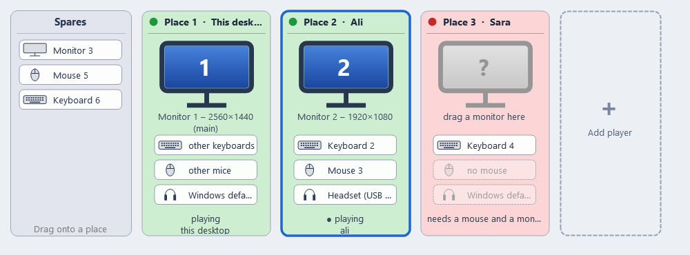

# Step-by-step guide

Examples use 2 players; for more, everything is the same with more players.

## 1. Hardware

- Plug the monitors into the graphics card (for more than 4 monitors see [hardware.md](hardware.md)).
- Plug in one keyboard, one mouse and one headset per player.
- In Windows *Settings → Sound*, rename the headsets so you can tell them apart
  (for example "Headset 2", "Headset 3"): click the device → *Rename*.

## 2. Windows Server

Install Windows Server 2022 or 2025 **"Desktop Experience"** (the version with the normal desktop).
Then install the latest graphics driver from NVIDIA / AMD / Intel, and Steam or your launchers.

## 3. Install MultiSeat

Run **`MultiSeat-Setup.exe`** (if Windows warns "Windows protected your PC": *More info → Run anyway*).
On Windows Server, tick **"Allow 4 to 8 players"** for more than 3 players. The PC restarts at the end.

## 4. Steam and games for each player

Each player needs their own Windows account (MultiSeat creates it in the next step). After adding the
players, you can sign in once as each one to install/sign in to Steam – or just do it the first time
they play.

## 5. Set up the players

Open **MultiSeat** (desktop icon).

1. Click **🖥 Identify monitors** – a big number appears on each screen.
2. Double-click **Seat 1 (this desktop)** and choose your own monitor.
3. Click **➕ Add player** for each extra player: user name (for example `player2`), a password, and
   the monitor. If the user doesn't exist yet, MultiSeat creates it. Choose the player's headset and microphone.
4. Click **🎮 Assign devices…**. On each player's monitor a big message appears: that player presses
   a key on **their** keyboard and clicks **their** mouse. (Esc skips.)
5. Click **✔ Check this PC**. Fix anything marked ✖.

The **Workplaces** tab shows one card per player ("Place 1", "Place 2", …) with its monitor number, keyboard,
mouse and headset. Green = playing, yellow = ready, red = something is missing. Everything not given to a place is
in **Spares**: drag a monitor, keyboard or mouse onto a place to give it to that player (dropping on another
player's place swaps them), or drag it back to Spares. Double-click a place to edit it (user, headset). The
**List** tab shows the same as a table.

## 6. Play

Press **▶ Start**. After a few seconds each player sees their own desktop on their monitor.

- Your keyboard and mouse stay on your screen.
- **Ctrl + Alt + F12** on a player's keyboard: that keyboard/mouse works on the main desktop for a
  moment (to fix something); press again to return.
- The **Status** column shows **● playing** while a player uses their keyboard or mouse – an easy way to
  check that every device goes to the right person.
- **■ Stop** closes the player screens. Players stay signed in, so a game keeps running and the next Start is fast.
- **Players → Sign out all players** signs them out completely. Right-click a player for more
  (reopen their screen, sign out only them).
- Minimizing MultiSeat while playing hides it to the tray icon.

## Settings (⚙ button)

| Setting | What it does |
|---|---|
| Start MultiSeat when I sign in to Windows | MultiSeat opens by itself after you sign in (also a checkbox in the installer). |
| …and start hidden in the tray | It waits as an icon next to the clock instead of opening the window. |
| Minimize to the tray | The – button hides MultiSeat next to the clock instead of the taskbar. |
| Close button keeps MultiSeat running | The X button hides it to the tray. Exit: right-click the tray icon → Exit. |
| Start the players automatically | Presses Start for you when MultiSeat opens. With "start when I sign in", the PC is ready to play right after sign-in. |
| Reopen a player's screen if it closes | On by default. |
| Keep my mouse on my own monitor | On by default. |
| Players' screens: 60 / 30 fps | 30 fps uses less graphics power with many players. |

Starting MultiSeat a second time (desktop icon, Start menu) just shows the one that is already running.

## Gamepads (experimental)

In Device Manager, open the gamepad → *Details* → *Device instance path*, copy it, and paste it into
the seat's *USB devices* box. The gamepad then belongs to that seat. If it doesn't work, please open
an issue with your gamepad model.
